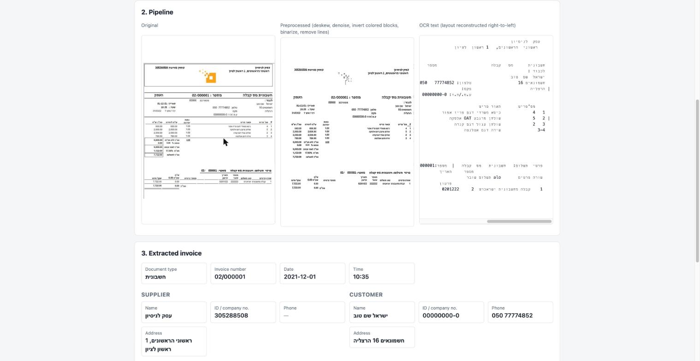
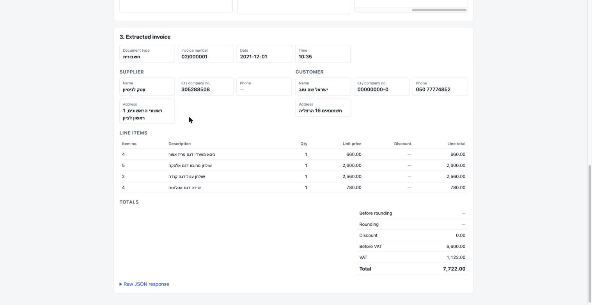
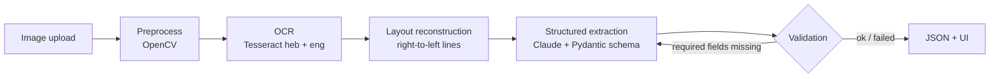

# Hebrew Invoice → JSON

Upload a photo or scan of an Israeli invoice or receipt and get back validated, structured JSON: document number, date, supplier and customer, line items, VAT and totals.

The pipeline combines classic computer vision (OpenCV + Tesseract OCR) with an LLM (Claude) for structured extraction. The model only reads text that the OCR actually found and is instructed never to calculate or guess missing values. Its output is validated, and failed checks go back to the model for one retry.




## How it works



1. **Preprocessing** (`image_to_json/pre_process.py`)
   - Denoises the image and estimates and corrects skew.
   - Crops to the content and upscales to 2000px width.
   - Inverts light-on-dark blocks (for example colored headers and totals bars) so all text ends up dark-on-light.
   - Applies an adaptive threshold and removes table lines.
2. **OCR** (`image_to_json/ocr.py`)
   - Runs Tesseract with Hebrew + English.
   - The Hebrew model misreads formatted amounts (`1,132.00` → `0`), so a second English pass replaces only money-shaped tokens and times that overlap a word the Hebrew pass found. It never touches Hebrew text, IDs or dates.
   - Words are then grouped into lines by baseline, and x positions are mirrored to rebuild the right-to-left layout, column spacing included.
3. **Extraction** (`image_to_json/model.py`)
   - Claude fills a Pydantic `Invoice` schema (`image_to_json/schemas.py`) through structured outputs.
   - The prompt forbids inferring or reconciling values that aren't legible on the page.
4. **Validation**
   - Checks the required fields (invoice number, total, line items) and the arithmetic (before VAT + VAT = total, rounding).
   - Missing required fields trigger one retry with the failed checks. The model is told to leave a field empty rather than borrow a value from another field.
   - Arithmetic mismatches are returned as warnings, never "fixed" by the model.
5. **API + UI** (`api/api.py`, `frontend/`)
   - FastAPI serves both the API and a small vanilla-JS page.
   - The page shows every pipeline stage and the extracted invoice.

## Quick start

Requirements: Python 3.14, [uv](https://docs.astral.sh/uv/), Tesseract with the Hebrew language pack, and an Anthropic API key.

```bash
# macOS
brew install tesseract tesseract-lang

uv sync
echo "ANTHROPIC_API_KEY=your-key" > .env

uv run fastapi run          # http://localhost:8000
```

Open http://localhost:8000. Upload an invoice or click one of the samples. A request takes roughly 10–30 seconds.

## API

| Method | Path | Description |
|---|---|---|
| `POST` | `/api` | Multipart `file` upload. `200` returns the extraction result. `422` means extraction ran but validation failed (the full result and failed checks are in `detail`). `400` means the file isn't an image. `502` means the LLM provider failed. |
| `GET` | `/api/samples` | Lists the demo invoices. |
| `GET` | `/api/samples/{name}` | Returns a demo invoice image. |

The response has these fields:
- `invoice`: the extracted data.
- `success`: whether the result passed validation.
- `errors`: failed required checks.
- `warnings`: arithmetic mismatches.
- `fixed_errors`: checks that failed on the first attempt and were fixed on the retry.
- `attempts`: how many LLM calls were made.
- `raw_text`: the reconstructed OCR text.
- `preprocessed_image`: the preprocessed image as a data URL.

## Evaluation

A CLI compares extraction pipelines on a labeled dataset of Hebrew invoices, measuring both accuracy and consistency:

```bash
uv run python -m eval run --pipelines ocr-claude,claude-vision --runs 3   # call the pipelines, save raw results
uv run python -m eval report                                             # re-score the latest saved run, no API calls
```

- **Pipelines:**
  - `ocr-claude` is this project's pipeline: preprocessing, OCR, extraction, validation and retry.
  - `claude-vision` sends the image straight to the same Claude model in one call, which shows what the OCR stage adds.
- **Accuracy:** every field is scored as correct, missed, wrong or hallucinated.
  - Line items are matched one to one.
  - Hebrew quotation marks, spaces and number formats are normalized.
  - The total is weighted toward the invoice number, the total and the line items.
- **Honest failures:** a blank template and an invoice with the total removed should fail validation, not get invented values.
- **Consistency:** repeated runs on the same invoice are compared field by field.

The latest results are in [eval/REPORT.md](eval/REPORT.md).

## Tests

```bash
uv run pytest
```

The unit tests mock the LLM. They cover:
- The retry and validation flow, including schema errors, empty model output and math warnings.
- How the prompt is built.
- The OCR number merge rules.
- The API status codes.
- The eval scoring: normalization, line-item matching, weights, consistency, and rendering the report from a saved run.

## Project structure

```
api/api.py                FastAPI app: /api, samples, serves the frontend
image_to_json/
  pre_process.py          OpenCV preprocessing
  ocr.py                  Tesseract + number merge + RTL layout reconstruction
  model.py                Claude extraction, validation, retry
  schemas.py              Pydantic invoice schema and value parsers
  main.py                 image bytes -> ExtractionResult
frontend/                 index.html, upload.js, style.css
eval/
  __main__.py             evaluation CLI (run / report)
  pipelines.py            pipelines under comparison
  scoring.py              field-level scoring and consistency
  report.py               terminal tables and REPORT.md
  dataset/                invoice images + labels
invoices/                 robustness variants (skewed, noised, numbers-only, missing price)
tests/                    unit tests
```

## Development journey

The project was built step by step, testing each stage on real Hebrew invoices and on deliberately broken variants.

1. **OCR baseline (Aug 23).** Started with plain Tesseract on a single retail invoice. Made variants of it (skewed, numbers-only) to see where OCR breaks, and drew word bounding boxes to inspect what Tesseract actually detects.
2. **Tables and lines (Aug 24–25).** Table borders were being read as characters. Separating horizontal and vertical lines from text with morphological operations led to the `remove_lines` step. Boxing each word showed that Tesseract's reading order scrambles right-to-left table rows.
3. **Image quality (Aug 26).** Compared resizing and threshold settings. Tested denoising on a noised copy of the invoice. Built skew estimation from the angles of text lines, ending with a single preprocessing workflow.
4. **Right-to-left layout (Aug 29).** Rebuilt lines from word coordinates. Grouping words by baseline and mirroring x positions gives text in Hebrew reading order with the columns kept, which helps the LLM tell labels from amounts. A real-world invoice with a colored header showed that light-on-dark text needed special handling.
5. **LLM extraction and validation (Sep 9–13).** The first version was a script: it read an image path, ran OCR, and asked Claude to fill a strict schema where the date, every total and each product ID were required. Several lessons reshaped it:
   - *Required fields invite guessing.* Forcing the model to produce a value pushes it to invent one when the page doesn't show it. The schema became nullable, and "required" moved into code (`check_required`), which can fail honestly or retry with feedback.
   - *Real values are messy.* Amounts arrive as `₪1,132.00` and dates in several formats, so value parsers (`CleanPrice`, `FlexibleDate`) clean them before validation. An early date format with a typo (`%d,%m,%y`) was fixed along the way.
   - *Invoices have two parties.* The single `Customer` model became a shared `Party` model for both supplier and customer. Per-item and whole-invoice discounts were added.
   - *Large invoices need room.* The output token limit was raised from 1,024 to 8,192 so long line-item tables aren't cut off.
   - *Deliberately broken inputs.* A "no price" variant and a "must be error" variant check that missing data produces an honest failure instead of an invented value.

   The script then became a service: images are processed as bytes in memory behind a FastAPI endpoint, with an upload page.
6. **Dataset and evaluation (Oct 5–15).** Collected 12 invoices from different systems and layouts (printed receipts, generated PDFs, colored templates, a phone photo). Started hand-labeling expected results and building a per-field comparison (matched / missed / wrong / hallucinated).
7. **Review and hardening (Oct 22).**
   - *Validation logic:*
     - Arithmetic checks were producing placeholder messages, so they now report real values.
     - The retry after a schema error now sends the error details.
     - Math problems are attached as warnings.
     - Malformed prices raise a validation error instead of crashing the server.
     - Unit tests cover the whole flow.
   - *Silent OCR failure:* end-to-end testing showed the Hebrew model reads amounts like `1,132.00` as `0`, so whole invoices came back with zero prices. Comparing language models on cropped rows found the cause. The fix is a conservative English pass limited to money-shaped tokens.
   - *Inversion fix:* the old light-on-dark detector was inverting a light-gray logo and missing the colored totals bar. It was rewritten to look for solid dark blocks instead, which recovered the colored headers on several invoices.
   - *Hallucination guard:* when the total was missing, the retry pushed the model to fill it with the rounding amount (`0.08` on a ₪1,632 invoice). The retry prompt now forbids borrowing values from other fields, so a missing total fails validation honestly.
   - *Demo:* FastAPI now serves the UI and sample invoices on one port, and the UI shows every pipeline stage.

8. **Evaluation CLI (Oct 22).** Rebuilt the half-finished evaluation script into a CLI that compares pipelines on accuracy and consistency, saves raw runs so they can be re-scored for free, and writes a report. Labels now cover every invoice in the dataset.

The remaining limitations and next steps are tracked in [TODO.md](TODO.md).
